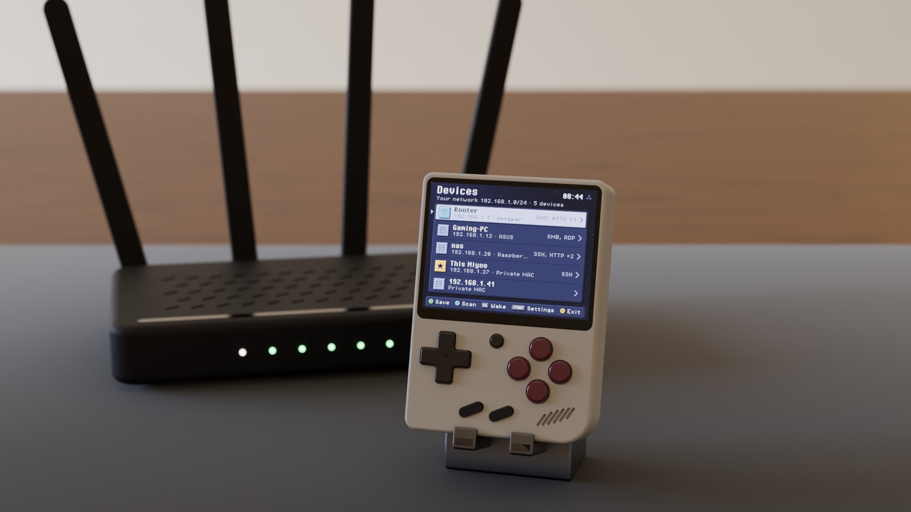
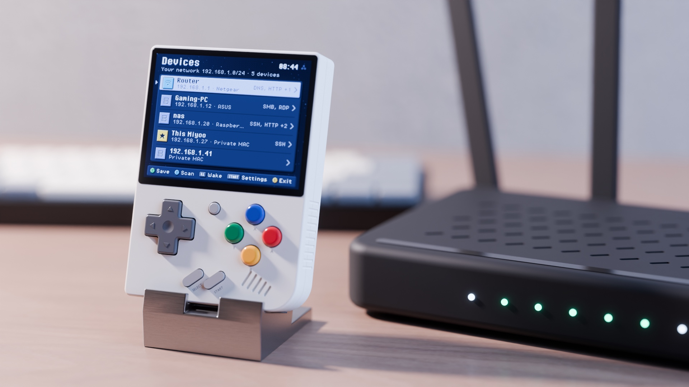

<p align="center"></p>

[](https://github.com/zakijss/MiniRadar/actions/workflows/ci.yml)
[](https://github.com/zakijss/MiniRadar/releases)
[](LICENSE)

# MiniRadar

The devices on your Wi-Fi network, and Wake-on-LAN, from a Miyoo Mini Plus. Part of [MiniDeck](https://github.com/zakijss/MiniDeck).

- Each device's IP and MAC address, maker, name and common open ports, from ordinary connections only.
- A list of computers to wake with Wake-on-LAN, added from a scan or by MAC address.
- **START** opens Settings: sort the devices by address, name or maker, and turn the port check off for quicker scans.


<p align="center"></p>

## Using it

It scans the network the Miyoo is on (up to 254 addresses) when it opens. **X** scans again, **A** opens a device, **Y** saves it for Wake, **L1** and **R1** switch between Devices and Wake, and **L2** and **R2** jump to the top and bottom of a list. On the Wake tab, **A** wakes a device and **Y** edits it.

The subtitle says how long ago the last scan ended. A device saved for Wake is listed under its saved name, and shows Awake on the Wake tab when the last scan found it. A device no scan found before is marked New until you next open the app.

The wake list is kept in `App/MiniRadar/devices.json`, Settings in `settings.json` beside it, and the devices earlier scans found (MAC addresses only, at most 512) in `seen.json`.

## Install

- **MiniMart:** open [MiniMart](https://github.com/zakijss/MiniMart), then **Apps > MiniRadar**. It checks the download and keeps your settings on updates.
- **Zip:** download `miniradar-VERSION.zip` from [Releases](https://github.com/zakijss/MiniRadar/releases/latest), unzip it onto the root of the SD card, and restart.
- **Every MiniDeck app at once:** [minideck-all.zip](https://github.com/zakijss/MiniDeck/releases/latest/download/minideck-all.zip).

## Requirements

A Miyoo Mini Plus on Onion OS 4.4, with Wi-Fi. Other devices and firmwares aren't supported.

## Building

```sh
make check                     # vet, tests, scripts
make package VERSION=1.0.0     # dist/: the release zip, app.json, SHA256SUMS
make deploy HOST=root@miyoo    # build and copy to a device over SSH
```

Go runs in Docker unless you pass `GO=go` (Go 1.27). The interface, themes and networking come from the [MiniDeck library](https://github.com/zakijss/MiniDeck); see its [development notes](https://github.com/zakijss/MiniDeck/blob/main/docs/DEVELOPMENT.md) and [contributing guide](https://github.com/zakijss/MiniDeck/blob/main/CONTRIBUTING.md).

## License

[MIT](LICENSE). Third-party components are listed in [NOTICE](NOTICE). Not made by or affiliated with Miyoo.
